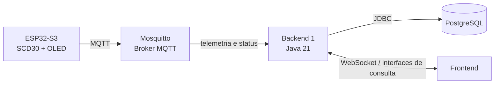

# CO2NNECT | Backend 1

**Servidor Java para recepção de telemetria ambiental via MQTT, persistência em PostgreSQL e comunicação com o frontend.**

O **CO2NNECT** é um sistema de monitoramento da qualidade do ar em ambientes internos, desenvolvido no Projeto Integrador IV da PUC-Campinas. Este repositório concentra o serviço servidor responsável por receber medições do dispositivo ESP32-S3, validar e armazenar dados, acompanhar o estado de conexão dos dispositivos e disponibilizar informações para os demais módulos.

> **Escopo deste repositório:** processamento e persistência no servidor. O firmware do ESP32-S3 está no [Backend 2](https://github.com/antune-ss/pi4-0102-g9-backend-2) e a interface web está no [Frontend](https://github.com/antune-ss/pi4-0102-g9-frontend).

## Arquitetura



O dispositivo publica as medições e seu estado de conexão no broker. O serviço Java assina os tópicos MQTT, interpreta os payloads e utiliza o PostgreSQL para persistência. A arquitetura também contempla comunicação com a aplicação web.

## Tecnologias

| Tecnologia | Utilização |
|---|---|
| Java 21 | Implementação do serviço servidor |
| Apache Maven | Dependências, compilação e testes |
| Eclipse Paho MQTT | Cliente MQTT para assinatura de tópicos |
| Eclipse Mosquitto | Broker de mensagens |
| PostgreSQL 16 | Persistência relacional |
| JDBC PostgreSQL | Acesso ao banco de dados |
| Gson | Conversão de mensagens JSON |
| WebSocket | Comunicação com clientes da aplicação |
| Docker Compose | Inicialização do broker e do banco |
| JUnit 4 | Testes automatizados |

## Responsabilidades do Backend 1

- **Ingestão MQTT:** recepção de leituras de CO₂, temperatura e umidade.
- **Validação:** verificação dos campos e dos limites definidos para as medições.
- **Persistência:** registro de leituras associadas a um identificador de dispositivo.
- **Estado do dispositivo:** processamento das mensagens de status online/offline.
- **Consultas:** operações de histórico e médias implementadas na camada de dados.
- **Integração:** interface de comunicação com a aplicação cliente.

## Estrutura do repositório

```text
pi4-0102-g9-backend-1/
├── broker/                   # Configuração adicional do broker
├── database/                 # Modelo, scripts e testes SQL
├── docs/
│   ├── adr/                  # Decisões de arquitetura
│   └── contratos/            # Contratos de integração
├── init-db/                  # Script de inicialização do banco
├── mosquitto/config/         # Configuração utilizada pelo Compose principal
├── scripts/                  # Scripts auxiliares de teste
├── src/
│   ├── Cliente/              # Código Java de cliente
│   ├── Servidor/             # Código Java de servidor
│   ├── main/java/br/puc/campinas/co2nect/
│   │   ├── App.java
│   │   ├── DatabaseManager.java
│   │   ├── MqttSensorSubscriber.java
│   │   ├── ReadingAverage.java
│   │   └── SensorReading.java
│   └── test/                 # Testes Java
├── docker-compose.yml
├── pom.xml
└── README.md
```

## Comunicação MQTT

O servidor utiliza os seguintes filtros de assinatura por padrão:

| Tipo | Tópico | Conteúdo |
|---|---|---|
| Telemetria | `co2nect/+/telemetry` | JSON com medições e identificação do dispositivo |
| Status | `co2nect/+/status` | `1` para online e `0` para offline |

O caractere `+` representa um identificador de dispositivo, permitindo a assinatura de mensagens de múltiplos sensores.

### Exemplo de telemetria

**Tópico:** `co2nect/ESP32-SALA-01/telemetry`

```json
{
  "deviceId": "ESP32-SALA-01",
  "co2": 850,
  "temperature": 24.5,
  "humidity": 45.2,
  "measuredAt": "2026-11-14T17:00:00Z"
}
```

### Exemplo de status

**Tópico:** `co2nect/ESP32-SALA-01/status`

```text
1
```

O assinante também aceita um objeto JSON com o campo `status`. A persistência é feita por `MqttSensorSubscriber` em conjunto com `DatabaseManager`.

## Modelo de dados

A camada Java trabalha com o registro de leituras ambientais contendo:

| Campo | Descrição |
|---|---|
| `id` | Identificador da leitura |
| `device_id` | Identificador do dispositivo |
| `co2` | Concentração de CO₂ em ppm |
| `temperature` | Temperatura em °C |
| `humidity` | Umidade relativa em % |
| `measured_at` | Instante da medição |
| `received_at` | Instante de recebimento, quando presente no esquema |

A camada `DatabaseManager` também utiliza a tabela `sensor_device` para cadastro e estado de conectividade. **O script SQL aplicado no banco deve ser compatível com a versão do código Java em execução.**

## Executando o ambiente

### Pré-requisitos

- JDK 21
- Apache Maven
- Docker e Docker Compose

### 1. Clonar o projeto

```bash
git clone https://github.com/antune-ss/pi4-0102-g9-backend-1.git
cd pi4-0102-g9-backend-1
```

### 2. Iniciar a infraestrutura

Na raiz do repositório:

```bash
docker compose up -d
docker compose ps
```

O `docker-compose.yml` principal publica:

| Serviço | Porta do host |
|---|---|
| Mosquitto (MQTT) | `1883` |
| PostgreSQL | `5432` |

O arquivo Compose inicia **Mosquitto e PostgreSQL**. O serviço Java é executado separadamente com Maven.

### 3. Configurar o servidor

O `App.java` aceita variáveis de ambiente, propriedades Java ou um arquivo `.env` na raiz de execução.

Exemplo de `.env` para desenvolvimento local:

```dotenv
MQTT_BROKER_URL=tcp://localhost:1883
MQTT_CLIENT_ID=co2nect-backend-1
MQTT_READINGS_TOPIC=co2nect/+/telemetry
MQTT_STATUS_TOPIC=co2nect/+/status
WEBSOCKET_PORT=8080

DB_URL=jdbc:postgresql://localhost:5432/co2nect_db
DB_USER=co2nect_user
DB_PASSWORD=co2nect_pass
```

### 4. Compilar e executar

```bash
mvn clean test
mvn exec:java
```

Para gerar o pacote:

```bash
mvn clean package
```

O `pom.xml` configura o Maven Shade Plugin para gerar um JAR com dependências e classe principal `br.puc.campinas.co2nect.App`.

> **Atenção à versão atual:** o código `App.java` referencia `SensorServer` e `MqttSensorSubscriber.java` referencia `SensorData`. Esses arquivos não constavam na árvore da branch `main` consultada em 14/11/2026. A compilação depende da presença dessas classes e da compatibilidade do esquema PostgreSQL.

## Testando a recepção MQTT

Com o broker ativo, é possível publicar uma medição de teste a partir de um terminal que possua os utilitários Mosquitto instalados:

```bash
mosquitto_pub -h localhost -p 1883 \
  -t "co2nect/ESP32-SALA-01/telemetry" \
  -m '{"deviceId":"ESP32-SALA-01","co2":850,"temperature":24.5,"humidity":45.2,"measuredAt":"2026-11-14T17:00:00Z"}'
```

No Windows PowerShell, execute o comando em uma linha ou utilize a continuação de linha apropriada para o shell.

Para acompanhar os logs do broker:

```bash
docker compose logs -f mosquitto
```

O recebimento e a gravação devem ser confirmados nos logs da aplicação Java e no PostgreSQL.

## Contratos de integração

Os contratos estão em [`docs/contratos/`](docs/contratos/):

| Contrato | Fronteira | Finalidade |
|---|---|---|
| CT2 — sensor_reading | Banco | Estrutura de persistência das leituras |
| CT4 — deviceCommand | MQTT | Comandos do servidor para o dispositivo |
| CT5 — listReadings | HTTP | Especificação de consulta de leituras |
| CT6 — getAverage | HTTP | Especificação de médias por período |

Os contratos **descrevem as interfaces previstas para o sistema**. A existência de um contrato não comprova que seu endpoint HTTP ou fluxo de comando esteja implementado e disponível no código publicado.

Os contratos CT1 (publicação de telemetria) e CT3 (status do sensor) estão documentados no [Backend 2](https://github.com/antune-ss/pi4-0102-g9-backend-2/tree/main/docs/contratos).

## Documentação técnica

- [`docs/FluxoBase.md`](docs/FluxoBase.md) — fluxo de referência do sistema.
- [`docs/adr/`](docs/adr/) — decisões de arquitetura, incluindo WebSocket e Docker.
- [`database/ERD.md`](database/ERD.md) — documentação do modelo relacional.
- [`database/tests/`](database/tests/) — testes SQL.
- [`src/test/`](src/test/) — testes Java.

## Repositórios do CO2NNECT

| Módulo | Repositório |
|---|---|
| Backend 1 — Servidor Java | [pi4-0102-g9-backend-1](https://github.com/antune-ss/pi4-0102-g9-backend-1) |
| Backend 2 — ESP32-S3 | [pi4-0102-g9-backend-2](https://github.com/antune-ss/pi4-0102-g9-backend-2) |
| Frontend — Interface web | [pi4-0102-g9-frontend](https://github.com/antune-ss/pi4-0102-g9-frontend) |

## Equipe

Projeto Integrador IV — PUC-Campinas.

- Bruna Rafaela Garcia de Oliveira
- Giovana Budri Oliveira
- Gustavo Antunes
- Júlia Rodrigues da Rocha
- Vítor Bergantin Ribeiro
- William Walter de Oliveira
- Yuri Kauan

---

**CO2NNECT** — Monitoramento ambiental conectado, com aquisição embarcada, processamento no servidor e visualização de dados.
