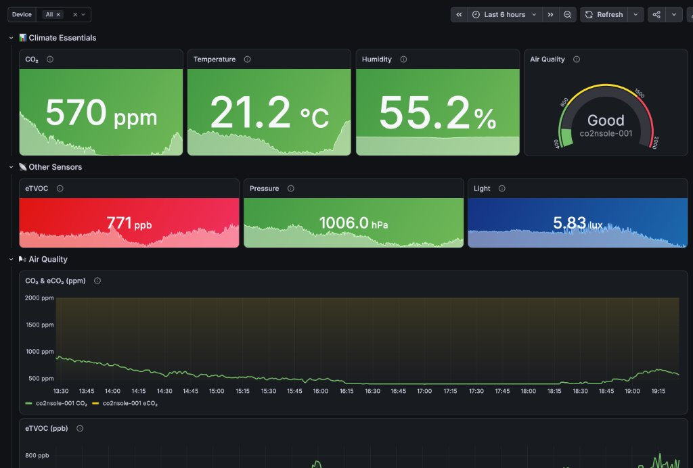
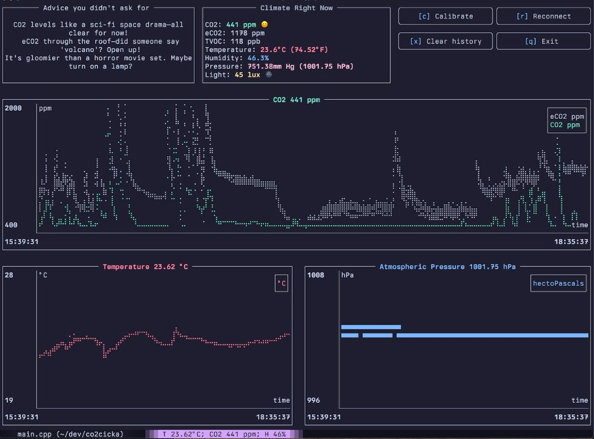

# CO2NNECT - Frontend

Sistema de monitoramento e auditoria da qualidade do ar em tempo real, desenvolvido com Next.js (App Router), TypeScript, Tailwind CSS v4 e shadcn/ui.

---

## Estrutura e Funcionalidades do Site

A aplicacao sera organizada em duas abas principais para dividir a experiencia entre visualizacao em tempo real e auditoria historica:

### 1. Aba Dashboard (Tempo Real)
- **Seletor de Dispositivo:** Dropdown para alternar o ESP32 visualizado ou selecionar todos.
- **Cards de Metricas Recentes:** 3 cards com os dados da ultima leitura (CO2, Temperatura e Umidade).
- **Graficos de Telemetria:** 3 graficos temporais dedicados para monitorar a evolucao continua de cada indicador.

### 2. Aba Historico (Auditoria e Leituras Criticas)
- **Filtros:** Filtragem por intervalo de datas (data inicial e data final) e por ID do dispositivo ESP32.
- **Destaque de Leituras Criticas:** Painel/filtro dedicado para identificar leituras acima dos limites seguros (por exemplo, CO2 elevado ou temperaturas anormais).
- **Tabela de Medicoes Completa:** Listagem paginada de todos os registros capturados com indicacao de status.

---

## Referencias e Inspiracao Visual

Abaixo estao as referencias de design utilizadas para guiar a disposicao dos cards, selecao de dispositivos e graficos:

### Painel de Telemetria e Selecao de Dispositivo
Referencia para a disposicao dos cards com a leitura mais recente, dropdown do ESP32 e organizacao dos graficos:



### Graficos Temporais de Sensores
Referencia para a exibicao continua das curvas e matrizes temporais de CO2, temperatura e umidade:



---

## Estrutura de Pastas do Projeto

A arquitetura e modular por telas (feature-based) para permitir o desenvolvimento paralelo por diferentes membros da equipe sem conflitos de versionamento:

```text
co2nect-frontend/
├── app/
│   ├── globals.css              # Cores OKLCH e tema Tailwind v4 (ja configurado)
│   ├── layout.tsx               # Fonte, metadados e favicon da logo
│   └── page.tsx                 # Pagina principal (controla apenas o Header e as Abas)
│
├── components/
│   ├── ui/                      # Componentes base do shadcn (Ninguem mexe aqui, se quiser mudar a cor, muda no globals.css)
│   │   ├── button.tsx
│   │   ├── card.tsx
│   │   ├── tabs.tsx             # Abas principais
│   │   ├── select.tsx           # Dropdown de selecao do ESP32
│   │   ├── badge.tsx            # Etiquetas de status (Normal / Atencao / Critico)
│   │   ├── table.tsx
│   │   └── chart.tsx            # Graficos base do Recharts
│   │
│   ├── dashboard/               
│   │   ├── DashboardTab.tsx     # Componente principal que orquestra a Aba 1
│   │   ├── MetricsCards.tsx     # Os 3 cards de leitura recente (CO2, Temp, Umidade)
│   │   ├── TelemetryCharts.tsx  # Container dos 3 graficos
│   │   ├── Co2Chart.tsx         # Grafico especifico de CO2 (linha/matriz temporal)
│   │   ├── TempChart.tsx        # Grafico de Temperatura
│   │   └── HumidityChart.tsx    # Grafico de Umidade
│   │
│   ├── history/                 
│   │   ├── HistoryTab.tsx       # Componente principal que orquestra a Aba 2
│   │   ├── HistoryFilters.tsx   # Barra de filtros (Datas De/Ate, ESP32 e filtro de Criticas)
│   │   ├── CriticalAlerts.tsx   # Destaque/resumo das leituras em nivel critico
│   │   └── HistoryTable.tsx     # Tabela de historico completa com paginacao e status
│   │
│   ├── Header.tsx               # Cabecalho compartilhado com Logo e titulo
│   ├── EspSelector.tsx          # Dropdown compartilhado de selecao de ESP32
│   └── Logo.tsx                 # Logo SVG do CO2NNECT
│
├── lib/
│   ├── services/                # Conexoes externas
│   │   ├── supabase.ts          # Queries de historico e Supabase Realtime
│   │   └── mqtt.ts              # WebSocket do broker MQTT
│   ├── types/
│   │   └── sensor.ts            # Interfaces TypeScript compartilhadas (SensorReading, etc.)
│   ├── mocks/
│   │   └── readingsMock.ts      # Dados mockados para ambos trabalharem offline
│   └── utils.ts                 # Helper cn() do shadcn
```

---

## Como Executar o Projeto

1. Instalar as dependencias:
```bash
pnpm install
```

2. Executar o servidor de desenvolvimento:
```bash
pnpm dev
```

3. Acessar a aplicacao no navegador:
```text
http://localhost:3000
```
