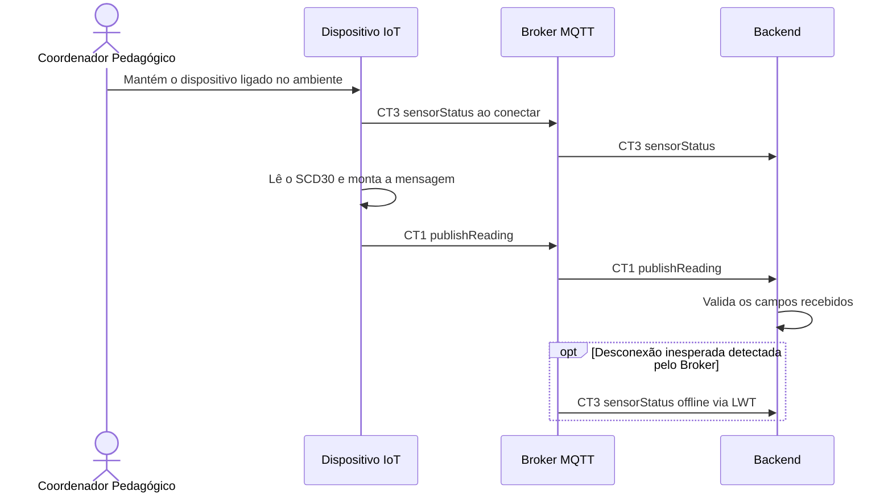

# Fluxo do E1 Leitura da qualidade do ar

**Feito quando da Entrega 1:** O sensor realiza a leitura de CO₂, temperatura e umidade, e os valores válidos são enviados ao sistema para processamento.

## Passos

1. O Coordenador Pedagógico mantém o Dispositivo IoT ligado no ambiente monitorado.
2. O Dispositivo IoT publica CT3 `sensorStatus` ao conectar ao Broker; o Broker encaminha o status ao Backend assinante. Esse status informa conectividade MQTT, não a validade da leitura do sensor.
3. O Dispositivo IoT solicita ao sensor SCD30 as leituras de CO₂, temperatura e umidade por I2C.
4. O Dispositivo IoT verifica se os valores são válidos e recentes e monta a mensagem com a identificação do dispositivo (`deviceId`) e o instante da medição (`measuredAt`).
5. O Dispositivo IoT publica a mensagem CT1 `publishReading` no Broker MQTT.
6. O Broker MQTT encaminha a mesma mensagem CT1 `publishReading` ao Backend assinante.
7. O Backend recebe os dados e valida os campos antes do processamento.
8. Em caso de desconexão inesperada, o Broker publica CT3 `sensorStatus` offline pelo Last Will and Testament (LWT), encaminhado ao Backend assinante.

## Diagrama

**Contratos usados:** CT1 `publishReading`, CT3 `sensorStatus`.

