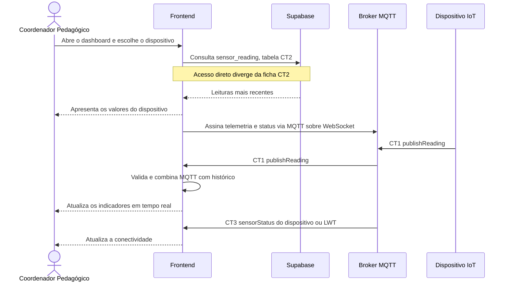

# Fluxo do E3 Visualização da qualidade do ar

**Feito quando da Entrega 1:** O usuário abre o dashboard e visualiza em tempo real os valores de CO₂, temperatura e umidade do ambiente monitorado, atualizados a cada nova leitura recebida.

## Passos

**Comportamento implementado:** o Frontend consome MQTT diretamente do Broker e consulta o histórico via Supabase.

1. O Coordenador Pedagógico abre o dashboard do Frontend e escolhe o dispositivo monitorado.
2. O Frontend consulta até 100 leituras na tabela `sensor_reading` via Supabase, ao abrir o dashboard e periodicamente a cada cinco segundos após a conclusão da consulta anterior. A tabela é descrita no CT2, mas esse acesso direto diverge da ficha, que atribui a leitura e a escrita ao Backend Java.
3. O Supabase devolve as leituras; o Frontend seleciona as do dispositivo e apresenta os valores de CO₂, temperatura e umidade da medição mais recente.
4. O Frontend mantém a conexão MQTT sobre WebSocket com o Broker, assinando a telemetria CT1 `publishReading` e a conectividade CT3 `sensorStatus`.
5. Quando o Dispositivo IoT publica CT1 `publishReading`, o Broker encaminha a mensagem ao Frontend assinante.
6. O Frontend valida a leitura, combina os dados MQTT com o histórico e atualiza os indicadores e gráficos sem recarregar a página.
7. O Broker também encaminha CT3 `sensorStatus`, publicado pelo dispositivo ou pelo LWT; o Frontend atualiza a indicação de conectividade.

## Diagrama

**Contratos usados:** CT1 `publishReading` e CT3 `sensorStatus` no caminho MQTT; CT2 `sensor_reading` como referência à tabela consultada, com a divergência de acesso indicada acima. As fichas CT1 e CT3 ainda listam apenas o Java como consumidor e precisam refletir também o consumo pelo Frontend.

## Arquitetura prevista e contratos pendentes

O desenho anterior previa uma consulta da medição atual ao Backend e um canal Backend → Frontend para novas medições. Conforme a nomenclatura do H01.4, essas referências passam a ser CT8 `consultarMedicaoAtual` e CT7 `novaMedicao`, respectivamente. As fichas CT7 e CT8 não foram localizadas nas branches auditadas dos três repositórios; seus nomes são referências do ticket, sem endpoints, payloads ou transporte formalizados.

Esses contratos pendentes não integram o diagrama implementado acima. O WebSocket usado atualmente transporta MQTT entre Frontend e Broker; não representa um evento CT7 enviado pelo Backend. CT5 `listReadings` é o contrato de histórico do E6 e não formaliza uma consulta de medição atual.

