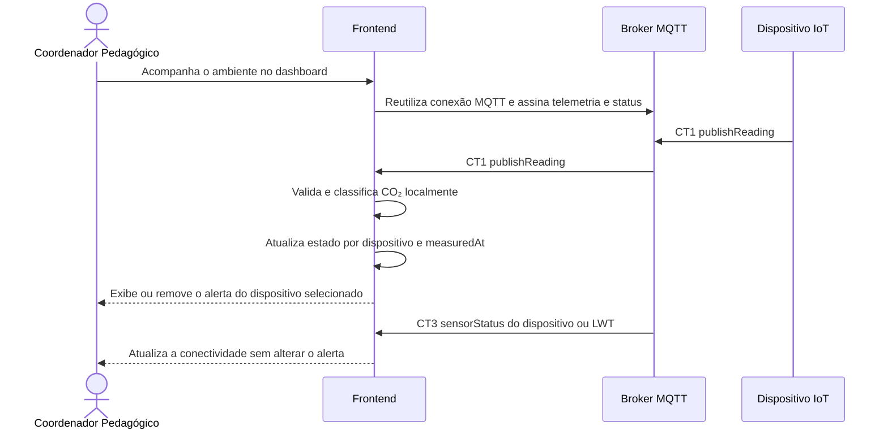
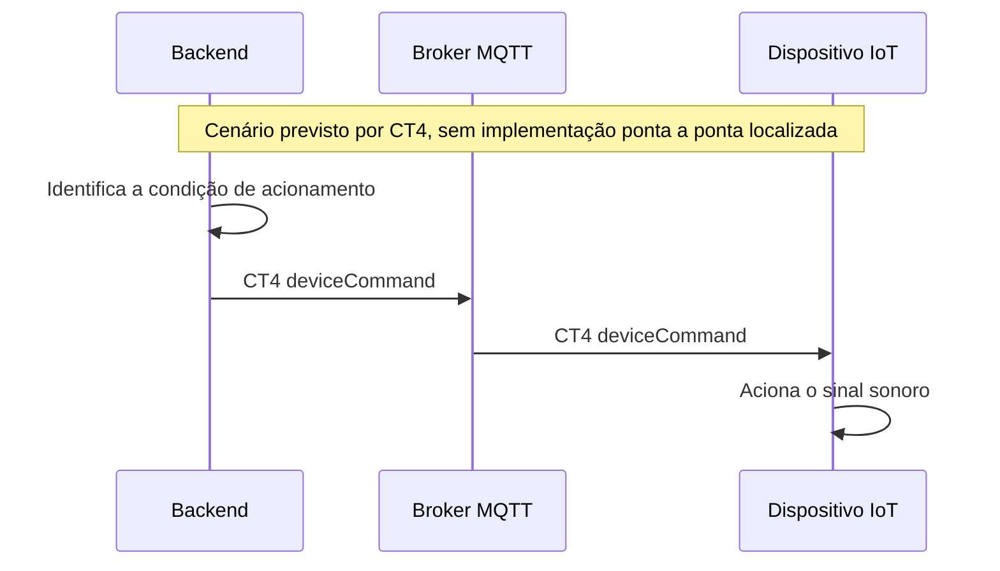

# Fluxo do E5 Mecanismos de alerta

**Feito quando da Entrega 1:** Quando os valores de CO₂ registrados ultrapassam o limite considerado saudável, o sistema exibe um alerta visual no dashboard e o dispositivo emite um sinal sonoro no local monitorado.

**Situação atual:** o alerta visual está implementado pelo H06.5 com classificação local da telemetria MQTT. O sinal sonoro permanece como comportamento arquitetural previsto pelo CT4; sua implementação ponta a ponta não foi localizada no backend e no firmware auditados.

## Passos — alerta visual implementado

1. O Coordenador Pedagógico mantém o dashboard aberto para acompanhar o dispositivo selecionado; o Frontend reutiliza a conexão MQTT existente com o Broker.
2. O Dispositivo IoT publica uma leitura CT1 `publishReading`; o Broker a encaminha ao Frontend assinante.
3. O Frontend valida a leitura e classifica localmente o CO₂. Uma leitura com CO₂ acima de 1.200 ppm ativa o alerta; uma leitura posterior aceita com CO₂ igual ou inferior a 1.200 ppm o desativa.
4. O Frontend mantém o estado por dispositivo, usa `measuredAt` para ordenar as atualizações e preserva o estado diante de leituras inválidas, duplicadas ou antigas. O banner apresenta o estado do dispositivo selecionado.
5. O Broker encaminha também CT3 `sensorStatus`, do dispositivo ou do LWT, para a indicação de conectividade. Esse status não ativa nem desativa o alerta de CO₂.

## Diagrama — alerta visual implementado

**Contratos usados:** CT1 `publishReading` e CT3 `sensorStatus` no caminho MQTT implementado. As fichas ainda precisam refletir o Frontend como consumidor. CT3 informa conectividade, não uma condição de alerta.

O H06.5 não recebe um campo oficial de alerta do Backend nem implementa CT7 `novaMedicao`. Esse identificador é a referência do ticket para o evento anteriormente previsto; sua ficha não foi localizada. CT2 `sensor_reading` e CT5 `listReadings` não participam da atualização do banner: o histórico não inicializa seu estado. Sem telemetria aceita, o estado é desconhecido. Uma reconexão na mesma montagem preserva o último estado, que pode ficar desatualizado; remontar o dashboard reinicia os estados, sem recuperação garantida de mensagens perdidas.

## Passos — sinal sonoro previsto

1. No cenário previsto, o Backend identifica uma condição que exige o sinal sonoro e publica CT4 `deviceCommand` no Broker MQTT.
2. O Broker encaminha a mesma mensagem CT4 `deviceCommand` ao Dispositivo IoT assinante.
3. O Dispositivo IoT aciona o sinal sonoro conforme o comando. A regra local de 1.200 ppm do H06.5 não define a regra do comando sonoro.

## Diagrama — sinal sonoro previsto

**Contratos usados:** CT4 `deviceCommand` no cenário sonoro previsto. Publicação e entrega utilizam a mesma ficha, sem contratos distintos para cada trecho MQTT.

