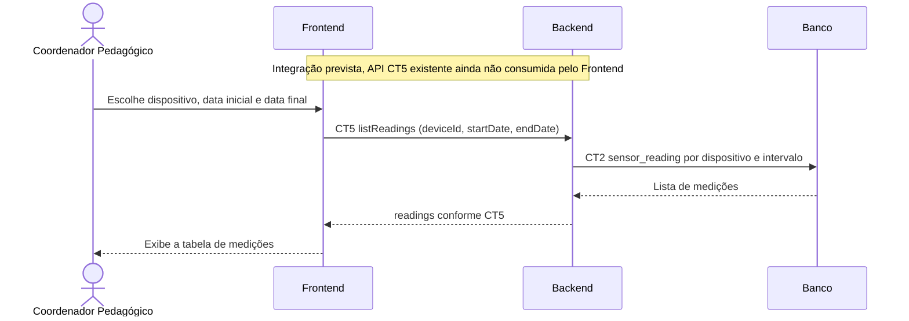

# Fluxo do E6 Consulta das medições

**Feito quando da Entrega 1:** O usuário pede para ver o histórico de medições de um dispositivo em um intervalo de datas, então o programa mostra uma tabela com as medições correspondentes.

**Situação atual:** os passos e o diagrama abaixo representam a integração prevista pelo CT5 `listReadings`, cuja API HTTP já existe no Backend. O Frontend atual ainda consulta até 100 leituras de `sensor_reading` via Supabase e aplica filtros localmente; não chama essa API. Esse acesso direto diverge do CT2, que atribui o acesso à tabela ao Java.

## Passos

1. O Coordenador Pedagógico abre a página de histórico no Frontend e escolhe o dispositivo, a data inicial e a data final.
2. Na integração prevista, o Frontend chama CT5 `listReadings` no Backend, por GET `/api/readings`, informando `deviceId`, `startDate` e `endDate`.
3. O Backend consulta as leituras do dispositivo e do intervalo na tabela `sensor_reading` por meio de CT2.
4. O Banco devolve as medições ordenadas da mais recente para a mais antiga.
5. O Backend devolve a lista `readings` ao Frontend, conforme CT5.
6. O Frontend apresenta as medições retornadas em uma tabela.

## Diagrama

**Contratos usados:** CT2 `sensor_reading` e CT5 `listReadings` na integração prevista ilustrada.

CT8 `consultarMedicaoAtual` é uma referência pendente do ticket para a consulta de medição atual do E3; não identifica o histórico.

