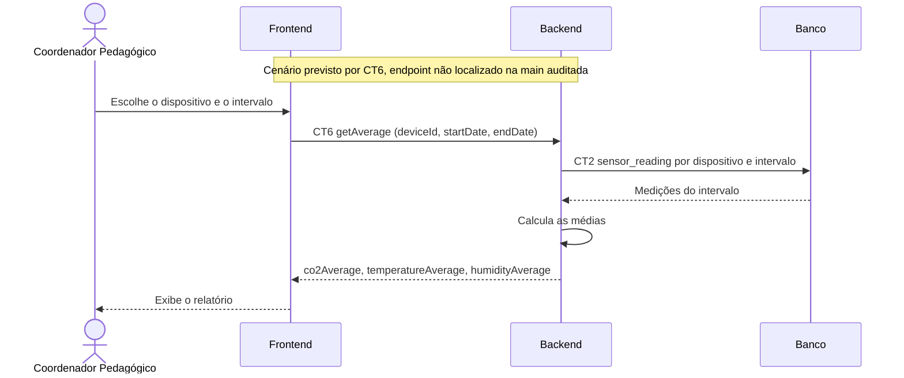

# Fluxo do E7 Relatórios de medições

**Feito quando da Entrega 1:** O usuário abre uma tela com a média das medições realizadas em um intervalo de tempo.

**Situação atual:** os passos e o diagrama abaixo representam o cenário previsto por CT6 `getAverage`. A ficha existe, mas o endpoint HTTP não foi localizado na `main` auditada do Backend. O Frontend atual calcula as médias localmente, na aba Histórico, sobre as leituras carregadas via Supabase e filtradas por dispositivo e datas; não chama CT6. Esse conjunto de até 100 leituras não garante cobertura de todo o período solicitado. O acesso direto à tabela `sensor_reading` diverge do CT2, que atribui o acesso ao Java.

## Passos

1. O Coordenador Pedagógico abre a página de relatórios no Frontend.
2. O Coordenador Pedagógico escolhe o dispositivo, a data inicial e a data final.
3. No cenário previsto, o Frontend chama CT6 `getAverage` no Backend, por GET `/api/readings/average`, informando `deviceId`, `startDate` e `endDate`.
4. O Backend consulta os registros correspondentes na tabela `sensor_reading` por meio de CT2.
5. O Backend calcula as médias de CO₂, temperatura e umidade no intervalo solicitado.
6. O Backend devolve `co2Average`, `temperatureAverage` e `humidityAverage`, conforme CT6; a ficha não define um campo de quantidade de medições.
7. O Frontend apresenta o relatório ao Coordenador Pedagógico.

## Diagrama

**Contratos usados:** CT2 `sensor_reading` e CT6 `getAverage` no cenário previsto ilustrado.
